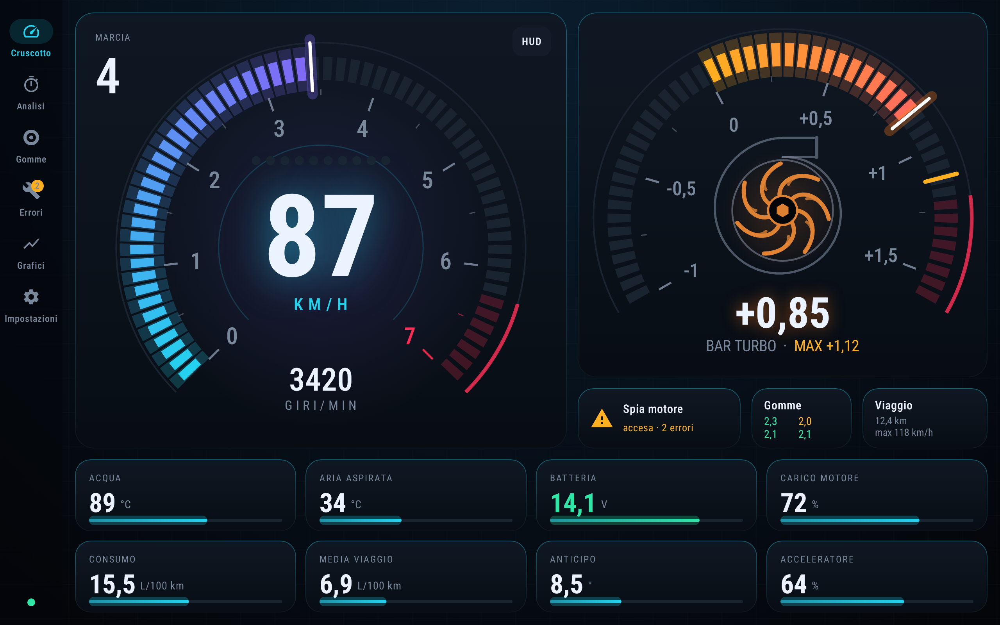
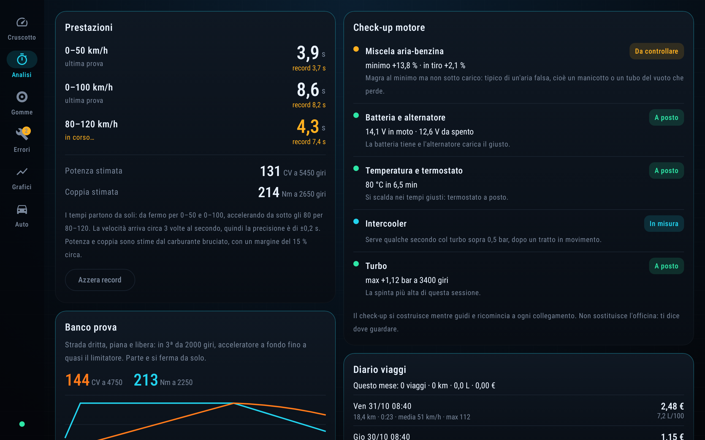
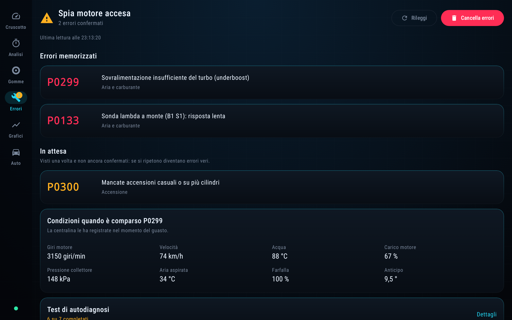
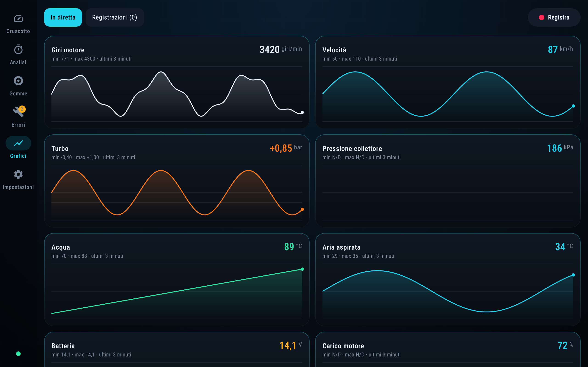
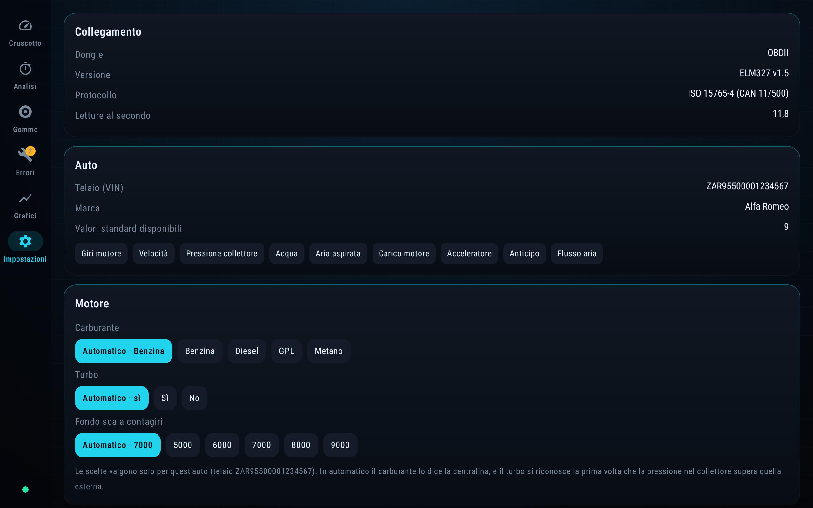

# Cruscotto

*[Read in English](README.md)*

**Un cruscotto OBD-II su misura per tablet Android.** Colleghi all'auto un dongle ELM327 da pochi euro e Cruscotto trasforma il tablet in un quadro strumenti dal vivo, con diagnosi, cronometro delle prestazioni, pressione delle gomme e diario dei viaggi.

L'ho fatta perché tutte le app OBD che ho provato sembravano vecchie e nascondevano i numeri che mi interessano. È un progetto personale: si installa come APK, non è sul Play Store. L'interfaccia è **in italiano o in inglese**, e si cambia dall'app.



> Tutti gli screenshot vengono dalla modalità demo integrata: un ELM327 finto che passa dallo stesso codice di un dongle vero.

## Cosa fa

- **Cruscotto dal vivo**: tachimetro con l'arco del contagiri a segmenti, shift light, indicatore della marcia inserita e un manometro del turbo animato, in bar. Sui motori aspirati diventa un vacuometro.
- **Codici errore**: legge gli errori memorizzati, in attesa e permanenti, le condizioni registrate al momento del guasto (freeze frame) e i test di autodiagnosi; cancella i codici dopo aver chiesto conferma.
- **Prestazioni**: cronometra da sola 0–50, 0–100 e 80–120 km/h, con i record per ogni auto, e stima potenza e coppia. Ha anche un "banco prova" che calcola la potenza dall'accelerazione in una marcia nota.
- **Check-up del motore**: si costruisce mentre guidi. Controlla le correzioni della miscela (per scovare le prese d'aria), batteria e alternatore, termostato, intercooler e turbo.
- **Riconoscimento della marcia**: impara i rapporti del cambio da giri e velocità, senza impostare niente.
- **Grafici e registrazioni**: grafici dal vivo degli ultimi 3 minuti. Le registrazioni si esportano in CSV che Excel apre direttamente, nel formato della lingua dell'app.
- **Pressione delle gomme**: sensori TPMS Bluetooth a tappino, assegnati ruota per ruota, con l'avviso di foratura lenta. Il decodificatore è ancora sperimentale.
- **Diario dei viaggi**: distanza, carburante consumato e costo di ogni viaggio.
- **Modalità HUD**: schermata specchiata da far riflettere sul parabrezza di notte.
- **Avvisi a voce**: avvisi parlati per motore freddo o turbo caldo.
- **Ascolto della rete CAN**: registra il traffico grezzo della rete CAN (ATMA) e lo riassume per indirizzo. Serve a scoprire i segnali specifici della casa.
- **Profili per auto**: impostazioni, record, rapporti delle marce e risultati del banco prova si salvano per telaio (VIN), così un tablet può servire più auto.
- **Italiano o inglese**: si sceglie nelle Impostazioni, e finché non scegli segue la lingua del tablet. Vale per tutte le schermate, le descrizioni dei codici errore, gli avvisi a voce, il formato di numeri e date e quello del CSV: punto e virgola e virgola decimale in italiano, virgola e punto decimale in inglese.

## Screenshot

<table>
  <tr>
    <td><br><sub>Cronometro delle prestazioni, check-up del motore, diario dei viaggi</sub></td>
    <td><br><sub>Codici errore e freeze frame</sub></td>
  </tr>
  <tr>
    <td><br><sub>Grafici dal vivo</sub></td>
    <td><br><sub>Impostazioni: collegamento, dati dell'auto, scelte sul motore, lingua</sub></td>
  </tr>
</table>

## Hardware supportato

| | |
|---|---|
| **Android** | 12 o successivo (minSdk 31), pensata per tablet ma usabile anche in verticale |
| **Dongle Bluetooth** | Cloni ELM327 col Bluetooth classico (SPP). Si abbinano una volta dalle impostazioni di Android; poi l'app si collega da sola. |
| **Dongle Wi-Fi** | Cloni ELM327 che creano una propria rete Wi-Fi. Prima ti colleghi a quella rete; l'app trova il dongle da sola (il router della rete, poi gli indirizzi più comuni come `192.168.0.10:35000`), oppure scrivi tu l'indirizzo. |
| **Non supportati** | Dongle Bluetooth LE (per ora) |
| **Auto** | Qualsiasi auto OBD-II / EOBD. Riconosce da sola benzina o diesel, turbo o aspirato. Sviluppata su un'Alfa Romeo MiTo 1.4 MultiAir Turbo del 2010. |

All'avvio l'app si ricollega all'ultimo dongle usato. Se il collegamento cade, continua a riprovare.

## Compilazione

Serve il JDK 21 e l'SDK di Android con la piattaforma `android-37`.

```sh
./gradlew assembleDebug            # APK in app/build/outputs/apk/debug/
./gradlew recordRoborazziDebug     # test + rigenera gli screenshot
```

Gli screenshot di questo README stanno in `app/screenshots/`, in italiano e in inglese. Anche le altre schermate vengono disegnate, come controllo visivo, in `app/build/screenshots/`.

`assembleDebug` passa prima da Lint, e un permesso mancante (`MissingPermission`) blocca la compilazione. La regola c'è perché una volta un permesso Bluetooth mancante ha rotto l'app in macchina senza dare segni.

## Struttura del progetto

```
app/src/main/java/com/mithole/cruscotto/
├── obd/        # protocollo e logica, niente interfaccia
│   ├── ElmLink.kt      # interfaccia del canale + collegamento Bluetooth
│   ├── WifiLink.kt     # collegamento Wi-Fi (TCP)
│   ├── DemoLink.kt     # ELM327 finto per la demo e i test
│   ├── Elm327.kt       # comandi AT, avvio, richieste dei PID
│   ├── Obd.kt          # ciclo di collegamento, letture, stato dell'app
│   ├── Analysis.kt     # cronometri, stima della potenza, check-up
│   ├── Lang.kt         # italiano / inglese
│   ├── Gears.kt  Dyno.kt  Tires.kt  Trips.kt  Recorder.kt  Sniff.kt  …
└── ui/         # schermate in Jetpack Compose
```

Kotlin, Jetpack Compose e Material 3. I test degli screenshot girano su Robolectric con [Roborazzi](https://github.com/takahirom/roborazzi), quindi non servono né un dispositivo né un emulatore.

## Avvertenze

- Potenza, coppia e consumi sono **stime**: il consumo viene dal flusso d'aria con un rapporto 14,7:1, e il banco prova usa valori ipotizzati per resistenza aerodinamica e al rotolamento. Vanno bene per confrontare le prove sulla stessa auto, non come numeri assoluti.
- I cloni ELM327 economici sono molto diversi tra loro. Alcuni ignorano i comandi avanzati, come l'ascolto della rete CAN.
- Non giocare con lo schermo mentre guidi. È proprio per questo che il cronometro parte e si ferma da solo.
