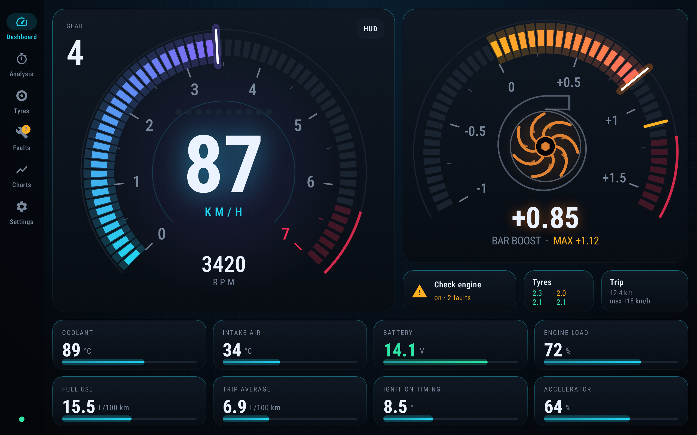
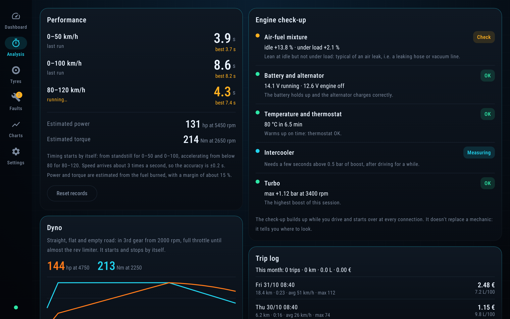
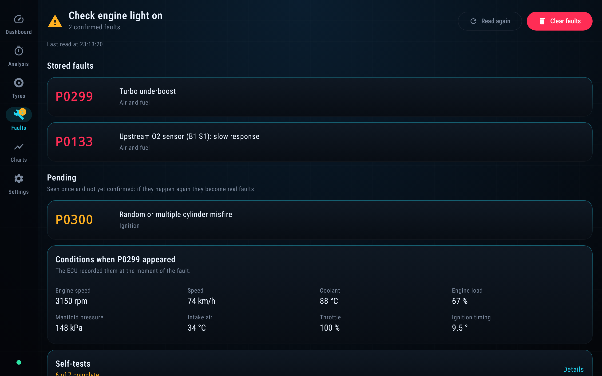
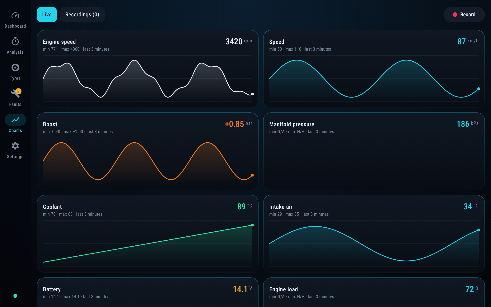
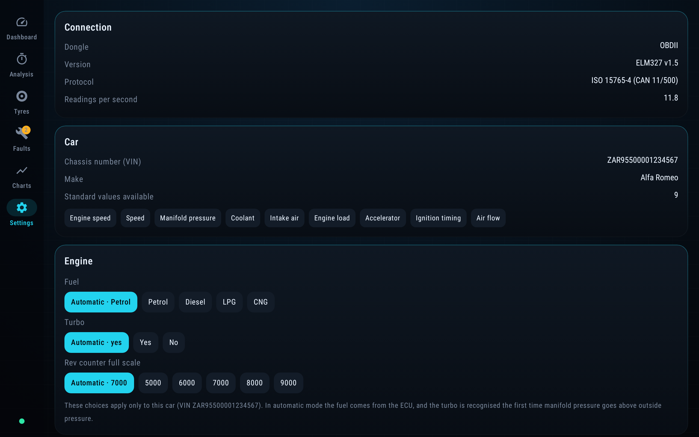

# Cruscotto

*[Leggi in italiano](README.it.md)*

**A custom OBD-II dashboard for Android tablets.** Plug a cheap ELM327 dongle into your car, and Cruscotto ("dashboard" in Italian) turns the tablet into a live instrument cluster with diagnostics, performance timing, tyre pressure and trip logging.

I built it because every OBD app I tried looked dated and buried the numbers I care about. It's a personal project, sideloaded as an APK and not on the Play Store. The UI is in **Italian or English**, switchable in the app.



> All screenshots use the built-in demo mode: a fake ELM327 that runs the same code paths as a real dongle.

## Features

- **Live dashboard**: speedometer with a segmented tachometer arc, shift lights, a current-gear badge and an animated turbo gauge showing boost in bar. Naturally aspirated engines get a vacuum gauge instead.
- **Fault codes**: reads stored, pending and permanent DTCs, freeze frame data and readiness monitors, and clears codes after asking for confirmation.
- **Performance**: automatic 0–50, 0–100 and 80–120 km/h timing, with per-car records, plus estimated power and torque. It also has a "dyno" mode that computes power from acceleration in a known gear.
- **Engine check-up**: built up while you drive. It covers fuel trims (to spot vacuum leaks), battery and alternator, thermostat, intercooler and turbo.
- **Gear detection**: learns your gearbox ratios from RPM and speed, with no setup needed.
- **Charts and recordings**: live charts of the last 3 minutes. Recordings export as CSV that Excel opens directly, in the format of the UI language.
- **Tyre pressure**: BLE TPMS valve-cap sensors with per-wheel assignment and slow-puncture warnings. The decoder is still experimental.
- **Trip log**: distance, fuel used and cost per trip.
- **HUD mode**: a mirrored display you can reflect on the windscreen at night.
- **Voice alerts**: spoken warnings for a cold engine or a hot turbo.
- **CAN bus listener**: records raw CAN traffic (ATMA) and summarises it by ID. It helps reverse-engineer manufacturer-specific signals.
- **Per-car profiles**: settings, records, gear ratios and dyno results are stored per VIN, so one tablet can serve several cars.
- **Italian or English**: chosen in Settings, and it follows the device language until you pick one. It covers every screen, fault-code descriptions, voice alerts, number and date formats, and the CSV format: semicolons and decimal commas in Italian, standard commas and decimal points in English.

## Screenshots

<table>
  <tr>
    <td><br><sub>Performance timing, engine check-up, trip log</sub></td>
    <td><br><sub>Fault codes and freeze frame</sub></td>
  </tr>
  <tr>
    <td><br><sub>Live charts</sub></td>
    <td><br><sub>Settings: connection, car info, engine overrides, language</sub></td>
  </tr>
</table>

## Supported hardware

| | |
|---|---|
| **Android** | 12 or newer (minSdk 31), designed for tablets and also usable in portrait |
| **Bluetooth dongles** | ELM327 clones over classic Bluetooth (SPP). Pair them once in Android settings; the app then connects by itself. |
| **Wi-Fi dongles** | ELM327 clones that create their own Wi-Fi network. Join that network first; the app finds the dongle by itself (network gateway, then common addresses like `192.168.0.10:35000`), or you can type the address. |
| **Not supported** | Bluetooth LE dongles (yet) |
| **Cars** | Any OBD-II / EOBD car. It detects petrol or diesel and turbocharged or naturally aspirated by itself. Developed for a 2010 Alfa Romeo MiTo 1.4 MultiAir Turbo. |

The app reconnects to the last dongle you used when it starts. If the link drops, it keeps retrying.

## Building

Requirements: JDK 21 and the Android SDK with platform `android-37`.

```sh
./gradlew assembleDebug            # APK in app/build/outputs/apk/debug/
./gradlew recordRoborazziDebug     # unit tests + regenerates the screenshots
```

The screenshots in this README are kept in `app/screenshots/`, in English and Italian. The other screens are rendered too, as visual checks, into `app/build/screenshots/`.

`assembleDebug` runs Lint first, and a missing runtime permission (`MissingPermission`) fails the build. That rule exists because a missing Bluetooth permission once broke the app silently in the car.

## Project layout

```
app/src/main/java/com/mithole/cruscotto/
├── obd/        # protocol and logic, no UI
│   ├── ElmLink.kt      # transport interface + Bluetooth link
│   ├── WifiLink.kt     # Wi-Fi (TCP) link
│   ├── DemoLink.kt     # fake ELM327 for demo mode and tests
│   ├── Elm327.kt       # AT commands, init, PID requests
│   ├── Obd.kt          # connection loop, polling, app state
│   ├── Analysis.kt     # timing, power estimate, check-up
│   ├── Lang.kt         # Italian / English
│   ├── Gears.kt  Dyno.kt  Tires.kt  Trips.kt  Recorder.kt  Sniff.kt  …
└── ui/         # Jetpack Compose screens
```

Kotlin, Jetpack Compose and Material 3. Screenshot tests run on Robolectric with [Roborazzi](https://github.com/takahirom/roborazzi), so no device or emulator is needed.

## Caveats

- Power, torque and fuel consumption are **estimates**: consumption comes from mass airflow at a 14.7:1 ratio, and the dyno uses assumed drag and rolling-resistance figures. They're good for comparing runs on the same car, not for absolute numbers.
- Cheap ELM327 clones vary a lot. Some ignore advanced commands such as CAN monitoring.
- Don't play with the screen while driving. Performance timing starts and stops by itself for exactly that reason.
